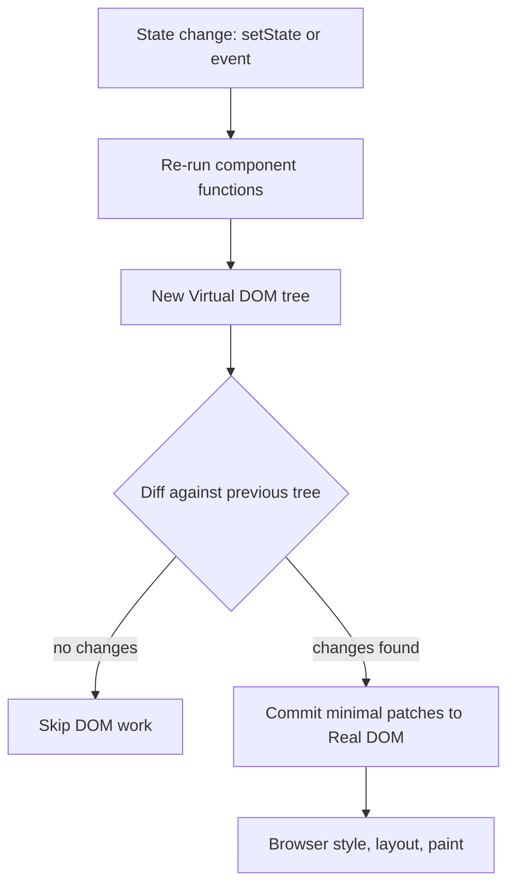

# Research Documentation

## 1. What problem does React solve that plain DOM manipulation struggles with?

The core problem is **keeping the UI in sync with changing data**. In plain JavaScript you describe *how to change* the page (imperative). In React you describe *what the page should look like* for a given state (declarative), and React works out the changes.

This project shows it concretely. The search has four states: idle, loading, success, error. In vanilla, every transition must explicitly build, clear or swap nodes (`show(renderLoader())`, `show(renderCard())`), toggle `disabled`, set `aria-busy`, and show/hide the validation message. In React the same behaviour is `status === 'loading' && <Loader />`.

### State management
- **Vanilla:** state lives in scattered variables and in the DOM itself (input value, `hidden` attributes, `disabled`). Nothing guarantees they agree.
- **React:** `useState` makes state explicit and single-sourced. The DOM is derived from it.

### UI synchronisation
Bugs like "the old error is still visible after a successful search" or "the button stayed disabled" come from forgetting one imperative update. React removes the class of bug: render output is a function of state, so stale UI cannot persist unless the state is wrong.

### Reusability
A React component packages markup + behaviour + props (`<PokemonCard pokemon={p} />`). In vanilla you can reuse functions that build nodes, but there is no standard unit that also carries state, lifecycle and updates.

### Scalability
With 4 states one `replaceChildren` is fine. With dozens of interdependent widgets (filters, lists, modals, forms) hand-managed updates form a web of dependencies. React's one-way data flow (state down, events up) keeps that tractable.

### Maintainability
Structure is enforced: components, props, hooks. A new developer can predict where logic lives. Vanilla projects rely on discipline and conventions, and drift as they grow.

### Developer productivity
JSX reads like the output, hot module reload preserves state during edits, and a large ecosystem (routing, data fetching, testing, UI kits) exists. The trade-offs are a build step, tooling and dependency maintenance.

---

## 2. What is the Virtual DOM?

### Real DOM
The browser's live tree of nodes that it renders. Reading or changing it can trigger style recalculation, layout and paint, which are the expensive parts. The DOM API itself is fast; it is the *work it triggers* that costs.

### Virtual DOM
A lightweight JavaScript object tree that mirrors the UI. Creating or comparing plain objects is cheap and has no side effects on the screen. In React, JSX compiles to calls that produce these description objects (React elements).

### Diffing
On every state change React renders the component function again, producing a **new** virtual tree, and compares it with the **previous** one. It uses heuristics to stay roughly linear in tree size:
1. Elements of different types (`div` vs `section`) are treated as different, so the subtree is replaced.
2. Same type: keep the DOM node, update only changed attributes/props.
3. Lists use `key` to match items between renders, so reorders move nodes instead of recreating them.

### Reconciliation
The whole process of deciding what changed and then applying the minimal set of real DOM operations (the "commit" phase). Modern React splits work into a render phase (pure, can be paused/prioritised) and a commit phase (touches the DOM synchronously).

### Selective updates
In this app, searching a new Pokémon changes text, an image `src`, and stat bar widths. React patches those specific properties; it does not rebuild the page shell (header, form, footer).

### Workflow diagram

```
 setState / event
        |
        v
 +----------------+      +------------------+
 |  Re-run render |----->|  New Virtual DOM |
 |  (component fn)|      |  tree (objects)  |
 +----------------+      +--------+---------+
                                  |
                                  v
                       +----------------------+
 Previous Virtual DOM ->|  Diff (compare trees)|
                       +----------+-----------+
                                  |  list of minimal changes
                                  v
                       +----------------------+
                       |  Commit: patch only  |
                       |  changed Real DOM    |
                       |  nodes               |
                       +----------+-----------+
                                  |
                                  v
                       Browser: style -> layout -> paint
```



### Advantages
- Declarative programming model; no manual update code.
- Batches updates and avoids redundant DOM writes.
- Abstraction that also powers non-DOM targets (React Native, server rendering).

### Limitations
- **Not inherently faster than hand-written DOM code.** It is overhead that buys convenience. Direct, targeted DOM updates are the lower bound.
- Memory and CPU cost to build and diff trees on every render.
- Large trees or unnecessary re-renders need care (`key`, `memo`, state placement).
- Adds runtime weight (see bundle comparison: ~70 KB gzip).
- Newer approaches (fine-grained reactivity such as Solid or Svelte's compile-time updates) avoid diffing altogether.

---

## 3. When is plain JavaScript the better choice?

| Scenario | Why vanilla fits |
|---|---|
| **Landing pages / marketing sites** | Content is mostly static; speed to first paint and SEO matter. A few lines of JS for menus or forms do not justify a framework. |
| **Small websites** | A handful of pages with light interactivity; zero build step, trivial hosting. |
| **Static pages** | HTML + CSS is enough. Adding a runtime to render static content is pure overhead. |
| **Widgets / embeds** | A third-party script embedded in other people's pages must be tiny, dependency-free and must not clash with the host's framework or version. |
| **Lightweight applications** | A single-view tool with few states (like this search, honestly) is perfectly maintainable in ~300 lines. |
| **Performance-critical projects** | Low-end devices, poor networks, or tight budgets: avoiding ~70 KB of runtime and hydration work gives faster startup, and manual targeted DOM updates can beat a diffing runtime in hot paths (games, canvas, animation loops). |
| **Learning and fundamentals** | Understanding the DOM, events and fetch makes any framework easier to use well. |

### Rule of thumb
Reach for React (or another framework) when the UI has **many interdependent pieces of state, many screens, or many contributors**. Stay with plain JavaScript when the page is **mostly content, has few states, or a hard size/performance budget**.

### Honest take on this project
Both versions work equally well for the user. React's win here is readability and safe state handling; vanilla's win is ~11x less code shipped. Neither is "wrong" at this scale, which is the real lesson.
